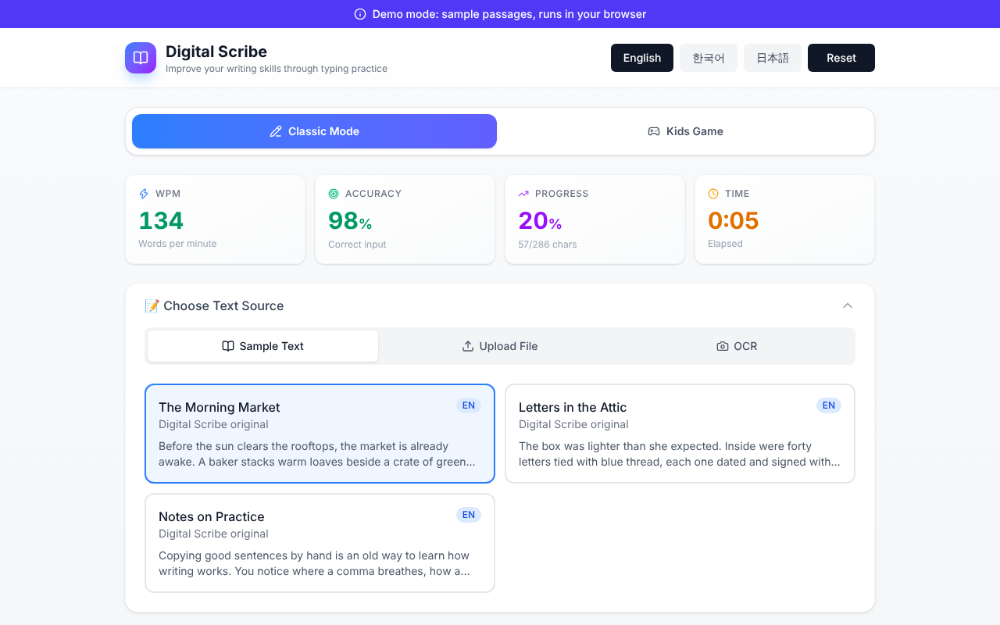

# Digital Scribe

A multilingual typing and transcription trainer for **English, Korean, and Japanese**. Pick a passage, upload your own text, or photograph a book page and let OCR turn it into practice material. Every keystroke is checked character by character with live speed, accuracy, progress, and time.



## Live demo

**[deokhwajeong.github.io/demos/digital-scribe](https://deokhwajeong.github.io/demos/digital-scribe/)**

The demo is a static export that runs entirely in your browser. It ships original sample passages in all three languages and a bundled book page with a precomputed OCR result, so the OCR flow works without downloading any OCR engine data.

## Features

- **Three languages**: English, Korean (한국어), and Japanese (日本語) UI and sample passages.
- **CJK aware metrics**: text is compared by Unicode code point after NFC normalization, so Hangul syllables, kana, kanji, and emoji each count as one character. Latin passages report WPM (5 characters per word); CJK passages report characters per minute (CPM), since word counts are not meaningful there.
- **IME friendly**: while a Korean or Japanese IME is still composing a character it is shown as pending (blue) rather than as a typo.
- **Your own text**: upload `.txt`, `.md`, `.json`, `.xlsx`, or `.csv` files. Spreadsheets are parsed in the browser.
- **OCR for book pages**: photograph or upload a page and extract text with [Tesseract.js](https://github.com/naptha/tesseract.js) (English, Korean, Japanese, or English plus Korean), or try the bundled sample page.
- **Kids game**: a 60 second word sprint with score and streak bonuses.

## Getting started

Requires Node.js 22 or newer.

```bash
npm install
npm run dev            # http://localhost:3000
```

| Script | What it does |
| --- | --- |
| `npm run dev` | Development server |
| `npm run build` / `npm start` | Production build and server |
| `npm run build:demo` | Static export for GitHub Pages into `out/` (basePath `/demos/digital-scribe`) |
| `npm run lint` | ESLint |
| `npm run typecheck` | TypeScript, no emit |
| `npm test` | Vitest unit tests |
| `npm run check` | All of the above in sequence |

### Static demo build

`npm run build:demo` sets `NEXT_PUBLIC_DEMO=1`, which turns on `output: 'export'`, `basePath: '/demos/digital-scribe'`, trailing slashes, and unoptimized images, and shows a small demo banner. Set `DEMO_BASE_PATH` to host it somewhere else. Because of the basePath, preview it locally from a parent folder:

```bash
npm run build:demo
mkdir -p /tmp/preview/demos && cp -r out /tmp/preview/demos/digital-scribe
python3 -m http.server 8080 -d /tmp/preview   # open http://localhost:8080/demos/digital-scribe/
```

## Tests

```bash
npm test
```

Unit tests live in `tests/` and cover the metrics logic in `lib/metrics.ts` (WPM and CPM, accuracy, code point counting, NFD vs NFC Hangul, IME composition, completion), the typing store (timer start and stop, resets), text helpers (OCR cleanup, CSV parsing), and i18n key parity across locales. CI runs lint, typecheck, tests, and both builds on every push and pull request.

## Project structure

```
app/            Next.js App Router entry (single page)
components/     Typing engine, metrics, file and OCR uploaders, kids game
data/           Original sample passages and the OCR sample
lib/metrics.ts  Pure typing metrics (unit tested)
lib/store/      Zustand stores (typing progress, locale)
lib/i18n/       Lightweight i18n with en, ko, ja messages
public/samples/ Bundled OCR sample page
```

## Tech stack

Next.js 16 (App Router), React 19, TypeScript, Tailwind CSS 4, Zustand, Tesseract.js, read-excel-file, Vitest.

## License

MIT
