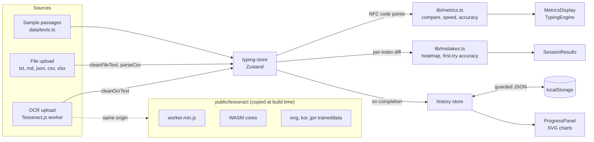

# Digital Scribe

A multilingual typing and transcription trainer for **English, Korean, and Japanese**. Pick a passage, upload your own text, or photograph a book page and let OCR turn it into practice material. Every keystroke is checked character by character with live speed, accuracy, progress, and time.


## Live demo

**[deokhwajeong.github.io/demos/digital-scribe](https://deokhwajeong.github.io/demos/digital-scribe/)**

The demo is a static export that runs entirely in your browser. It ships original sample passages in all three languages and a bundled book page with a precomputed OCR result for an instant first look. Uploading your own image runs real OCR on your device, with the engine and language data served from the same site (no third-party CDN, nothing uploaded).

## Features

- **Three languages**: English, Korean (한국어), and Japanese (日本語) UI and sample passages.
- **CJK aware metrics**: text is compared by Unicode code point after NFC normalization, so Hangul syllables, kana, kanji, and emoji each count as one character. Latin passages report WPM (5 characters per word); CJK passages report characters per minute (CPM), since word counts are not meaningful there.
- **IME friendly**: while a Korean or Japanese IME is still composing a character it is shown as pending (blue) rather than as a typo.
- **Results and mistake heatmap**: after each passage you get net speed, accuracy, first-try accuracy, total mistakes (including ones you fixed with Backspace), a per-character heatmap of where you slipped, and your most missed characters.
- **Progress history**: every finished passage is saved in your browser (localStorage). A progress panel shows sessions, personal best, last-5 averages with trend, speed and accuracy charts per language, and a table view. Nothing leaves the device.
- **Your own text**: upload `.txt`, `.md`, `.json`, `.xlsx`, or `.csv` files. Spreadsheets are parsed in the browser.
- **OCR for book pages**: photograph or upload a page and extract text with [Tesseract.js](https://github.com/naptha/tesseract.js) (English, Korean, Japanese, or English plus Korean), or try the bundled sample page. The worker, WASM core, and language data are self-hosted (see below).
- **Kids game**: a 60 second word sprint with score and streak bonuses.

## Getting started

Requires Node.js 22 or newer.

```bash
npm install
npm run dev            # http://localhost:3000
```

| Script | What it does |
| --- | --- |
| `npm run dev` | Development server |
| `npm run build` / `npm start` | Production build and server |
| `npm run build:demo` | Static export for GitHub Pages into `out/` (basePath `/demos/digital-scribe`) |
| `npm run lint` | ESLint |
| `npm run typecheck` | TypeScript, no emit |
| `npm test` | Vitest unit tests |
| `npm run check` | All of the above in sequence |

### Static demo build

`npm run build:demo` sets `NEXT_PUBLIC_DEMO=1`, which turns on `output: 'export'`, `basePath: '/demos/digital-scribe'`, trailing slashes, and unoptimized images, and shows a small demo banner. Set `DEMO_BASE_PATH` to host it somewhere else. Because of the basePath, preview it locally from a parent folder:

```bash
npm run build:demo
mkdir -p /tmp/preview/demos && cp -r out /tmp/preview/demos/digital-scribe
python3 -m http.server 8080 -d /tmp/preview   # open http://localhost:8080/demos/digital-scribe/
```

## Architecture



All logic that can be pure is pure (`lib/metrics.ts`, `lib/mistakes.ts`, `lib/history.ts`, `lib/text.ts`, `lib/ocr-assets.ts`) and unit tested; components only render store state.

## Design decisions

- **One hidden textarea, not keydown handling.** Korean and Japanese text is produced by an input method editor (IME), so individual key events do not map to characters. The typing area is a transparent `<textarea>` over the rendered passage; the app reads its value on `input` and tracks `compositionstart` / `compositionend`. While composing, the last character is shown as pending instead of as an error, so a half-built Hangul syllable (for example `ㄱ` on the way to `가`) or unconverted kana is never punished. A passage only completes if the final composed character already matches.
- **Unicode normalization and code points.** Input and target are normalized to NFC and compared with `Array.from`, so a Hangul syllable typed as decomposed jamo (NFD, common on some platforms) matches the precomposed form, and astral characters (emoji, rare kanji) count as one character instead of two UTF-16 units.
- **CPM for Korean and Japanese, WPM for Latin text.** WPM assumes a word is 5 characters separated by spaces. Japanese has no spaces, and one Korean syllable already bundles 2 or 3 keystrokes, so "words" are meaningless there. Passages whose letters are mostly CJK report characters per minute; history is kept per language so the two units are never mixed on one chart.
- **Mistakes are remembered, not just the current state.** Live accuracy reflects what is on screen now, which hides typos fixed with Backspace. The store diffs each input update against the previous one and counts every newly committed wrong character per target position (IME-pending characters excluded). That powers the heatmap and the first-try accuracy figure.
- **Self-hosted OCR.** `scripts/copy-ocr-assets.mjs` copies the Tesseract.js worker, its three WASM cores (relaxed SIMD, SIMD, plain; the browser picks one), and the `best_int` English, Korean, and Japanese models from `node_modules` into `public/tesseract/` before `dev`, `build`, and `build:demo`. About 20 MB on disk, but loaded only when someone runs OCR on their own image, and then cached by the browser. The output is gitignored. Tesseract puts spaces between Japanese characters, so `cleanOcrText` removes spaces that sit between two Japanese characters while keeping Latin and Korean word spacing.
- **Storage is never trusted.** History reads and writes go through try/catch with schema checks; private windows, blocked storage, or a corrupted entry fall back to an empty history instead of breaking the page.

## Tests

```bash
npm test
```

Unit tests live in `tests/` and cover the metrics logic in `lib/metrics.ts` (WPM and CPM, accuracy, code point counting, NFD vs NFC Hangul, IME composition, completion, language detection), mistake tracking (corrections, IME pending characters, heat levels, most missed characters), session history (storage round trip, corrupt or blocked storage, caps, summaries and trends), the typing store (timer, resets, recording a finished session), OCR asset paths and bundled model presence, text helpers (OCR cleanup including Japanese spacing, CSV parsing), and i18n key parity across locales. CI runs lint, typecheck, tests, and both builds on every push and pull request.

The static demo is also checked end to end in a headless browser before publishing: typing a passage in each language, the results card and heatmap, history persistence across reloads, custom-image OCR in English, Korean, and Japanese with all network requests same-origin, and a 390 px wide layout.

### Known advisory

`npm audit` reports a high severity `braces` advisory reached only through `eslint-config-next` (a lint-time dev dependency). No patched release exists yet; it does not ship in the app bundle.

## Project structure

```
app/            Next.js App Router entry (single page)
components/     Typing engine, metrics, file and OCR uploaders, kids game
data/           Original sample passages and the OCR sample
lib/metrics.ts  Pure typing metrics (unit tested)
lib/mistakes.ts Per-character mistake tracking for the heatmap
lib/history.ts  Session history persistence and summaries
lib/store/      Zustand stores (typing progress, history, locale)
scripts/        Build-time copy of self-hosted OCR assets
lib/i18n/       Lightweight i18n with en, ko, ja messages
public/samples/ Bundled OCR sample page
public/tesseract/ Generated: OCR worker, cores, language data (gitignored)
```

## Tech stack

Next.js 16 (App Router), React 19, TypeScript, Tailwind CSS 4, Zustand, Tesseract.js, read-excel-file, Vitest.

## License

MIT
